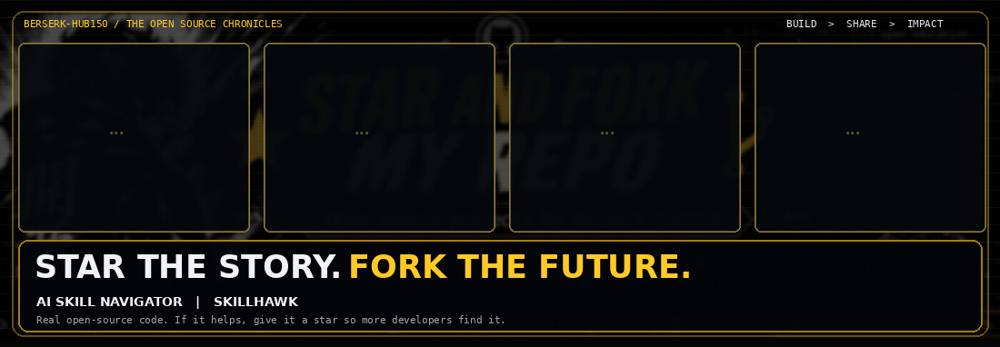

  

  <b>If a project helps you, give it a star — it helps other developers discover it.</b>

* 🎓 **[Moodle AI Skill Navigator](https://github.com/Berserk-hub150/moodle-ai-skill-navigator)** — personal open-source project
* 🛡️ **[SkillHawk](https://github.com/Berserk-hub150/skillhawk)** — security scanner for AI Agent Skills, `SKILL.md` files, and MCP configurations
